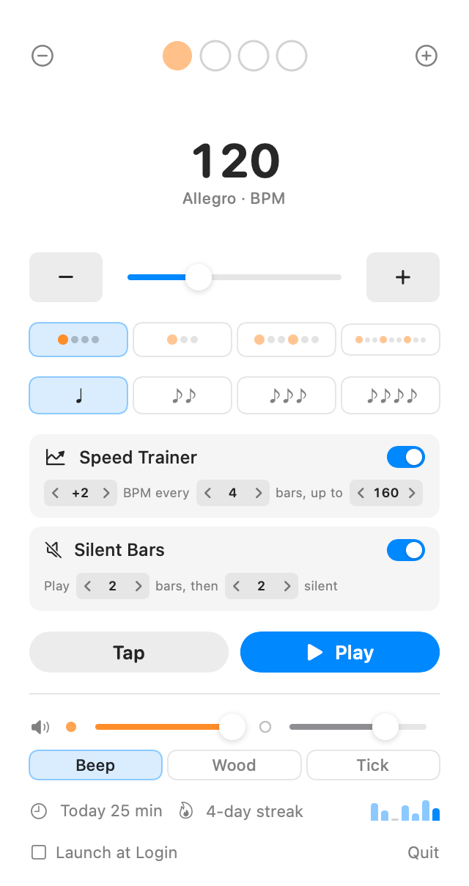

# Pulstick

A minimal metronome that lives in your macOS menu bar.

**https://ash1day.github.io/Pulstick/** ([日本語](https://ash1day.github.io/Pulstick/ja/))



## Features

- Tempo 30–300 BPM: drag, use the ± buttons (hold to keep going) or arrow keys, tap along, or click the number and type
- Up to 16 beats per bar; click a beat to cycle normal → accent → rest, or right-click it to pick one (e.g. click only on 2 and 4), plus four presets you can overwrite (right-click)
- Songs: save the tempo, beat pattern and subdivision under a song name, recall it in one click, and see how long you have practised each song. Songs keep setlist order (right-click to move, update with the current settings, delete, or practise at 70–90 % of the tempo) and `[` / `]` step through them. Copy and paste a setlist to share it with your band
- Subdivisions: eighths, triplets, swing, sixteenths
- Three click sounds (beep, wood, tick), all synthesized in code
- Mute: click the speaker to silence the click while the beat display (and the menu bar beat number) keeps going
- Speed trainer: raise the tempo by N BPM every M bars up to a target, optionally repeating from the start tempo. The line under the BPM counts down to the next step, and VoiceOver announces each new tempo
- Silent bars: play N bars, then mute M bars to check you hold the tempo yourself
- Menu bar shows the BPM while playing; the Play button shows practice time
- Practice timer and count-in: right-click Play to stop automatically after 5–60 minutes, or to hear one or two bars before you start
- Practice log: minutes practised today and a 7-day chart (right-click to reset)
- Global shortcuts: <kbd>⌃⌥M</kbd> play/stop, <kbd>⌃⌥T</kbd> tap tempo, <kbd>⌃⌥,</kbd> / <kbd>⌃⌥.</kbd> previous/next song
- Settings are remembered between launches
- Follows the system accent colour, light and dark mode
- English and Japanese UI (follows the system language), VoiceOver labels, and Reduce Motion / Increase Contrast support

See [CHANGELOG.md](CHANGELOG.md) for what changed in each version.

## Build

```bash
./build.sh
```

Requires Xcode (the SwiftUI macros are not in the Command Line Tools alone). `build.sh` uses Xcode automatically when `xcode-select` points at the CLT.

## Development

```bash
./dev.sh                     # rebuild and relaunch the app
swift test                   # unit tests (silent: they never play audio)
.build/debug/Pulstick --snapshot out.png [--dark] [--beats N] [--trainer] [--gap] [--log] [--songs] [--muted] [--shortcuts] [--timer] [--contrast] [--welcome] [--rests] [--song] [--countdown]
                             # render the popover to a PNG without launching the app
./scripts/update-screenshots.sh  # refresh the landing page screenshots (English and Japanese)
```

## Release

Push a tag such as `v1.1.0`; GitHub Actions runs the tests, builds a universal (Apple Silicon + Intel), ad-hoc signed app and attaches `Pulstick.zip` to the release. Locally, `UNIVERSAL=1 ./build.sh` does the same build. The app is not notarized, so on first launch macOS asks for confirmation: right-click `Pulstick.app` and choose **Open**.

## App icon

```bash
swift scripts/make-icon.swift   # regenerates Resources/AppIcon.icns and docs/icon.png
```

## License

MIT
